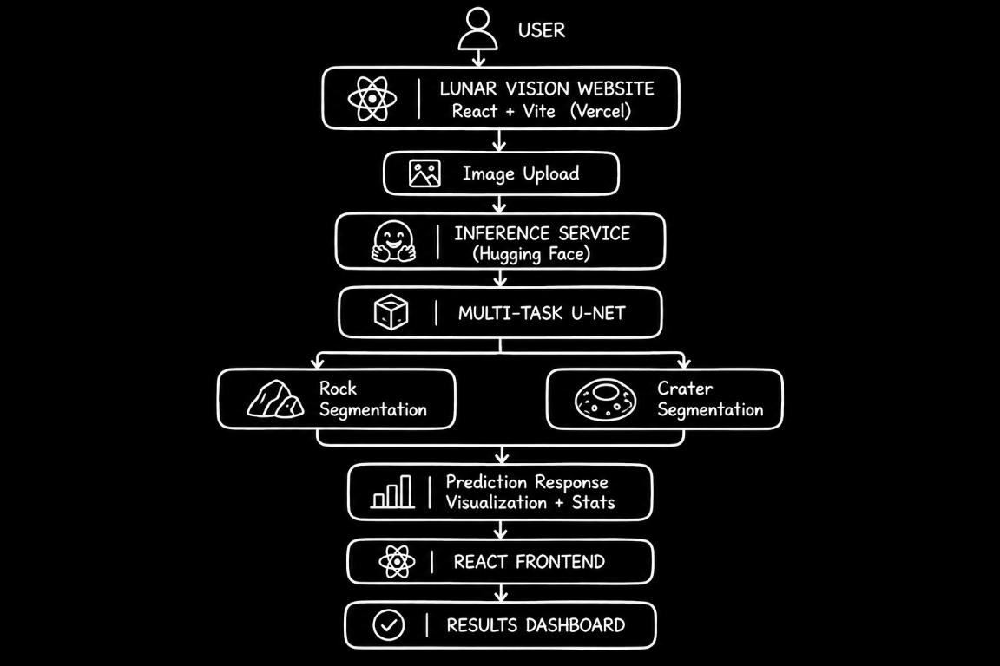

# Lunar Vision — Lunar Terrain Analysis Platform

**An interactive web platform for AI-powered lunar terrain segmentation and crater detection.**

<p align="center">
  <a href="https://lunar-vision-phi.vercel.app/">Live Demo</a> ·
  <a href="https://github.com/darshanbagade/lunar-vision">Frontend Repository</a> ·
  <a href="https://github.com/Atharva130/Lunar-Terrain-Segmentation">ML Research Repository</a>
</p>

---

## Overview

Lunar Vision is a web-based application designed to visualize AI-powered lunar terrain analysis. It provides an interactive interface for uploading lunar surface images, processing them through a deep learning model, and exploring the resulting rock segmentation and crater detection outputs.

The application connects a React-based frontend with a separately deployed machine learning inference service. It presents model predictions through visual overlays, an animated processing workflow, and terrain statistics.

The project consists of two independently maintained components:

| Component        | Responsibility                                                                              |
| ---------------- | ------------------------------------------------------------------------------------------- |
| Frontend         | User interface, image upload, API integration, visualization, and website deployment        |
| Machine Learning | Model architecture, dataset preparation, training, evaluation, and inference implementation |

**Live Application:** [lunar-vision-phi.vercel.app](https://lunar-vision-phi.vercel.app/)

## Features

- **Interactive Image Upload:** Upload lunar surface images through drag-and-drop or file selection.
- **Inference Workflow:** Animated processing pipeline with a rover-inspired indicator and visual stage progression.
- **Rock Segmentation:** Visualize segmentation results for sky, rock, boulder, and ground classes.
- **Crater Detection:** Display predicted crater segmentation.
- **Prediction Visualization:** Explore the original image, individual model outputs, and combined overlay.
- **Terrain Statistics:** View prediction statistics returned by the inference service.
- **Full-Screen Inspection:** Inspect generated prediction visualizations in an expanded view.
- **Responsive Interface:** Access the application across desktop, tablet, and mobile screen sizes.
- **Lunar-Inspired Design:** Custom interface featuring animated stars, moon effects, and rover-inspired visual elements.

## Application Preview

<!-- Add screenshots to the screenshots/ directory and uncomment these examples. -->

<!-- <p align="center">
  
</p>
<p align="center">
  
</p>
<p align="center">
  
</p> -->

## Frontend Engineering

The frontend application is developed and maintained in this repository.

### Application Architecture

The frontend follows a component-based React architecture, with separate pages and reusable UI components for navigation, image upload, inference workflow, and result presentation.

### 1. User Interface and Experience

- Developed a multi-page application using React.js and Vite.
- Implemented responsive layouts and reusable components.
- Styled the application using Tailwind CSS.
- Used Framer Motion for interface animations and transitions.
- Integrated Lucide React icons throughout the application.
- Created a lunar-inspired visual experience with animated backgrounds and rover-themed interactions.

### 2. Image Upload and API Integration

- Implemented drag-and-drop and file-selection workflows.
- Integrated the frontend with the deployed inference service using Axios.
- Configured the API endpoint through environment variables.
- Handled image submission, API responses, and prediction data.
- Implemented frontend states for the inference workflow.

### 3. Prediction Visualization

- Rendered the original lunar image alongside the model's segmentation outputs.
- Implemented a four-panel visualization layout.
- Displayed the combined prediction overlay.
- Added full-screen result inspection.
- Presented terrain statistics and prediction information returned by the API.

### 4. Processing Workflow

- Designed an animated inference pipeline to communicate processing stages.
- Implemented a rover-inspired indicator that moves through the workflow.
- Highlighted completed stages to provide visual feedback during processing.

## Machine Learning Integration

The frontend integrates with a separately developed and deployed machine learning model hosted on Hugging Face Spaces.

The integration follows this workflow:

1. The user uploads a lunar surface image.
2. The frontend submits the image to the inference API.
3. The deployed model performs lunar terrain segmentation.
4. The API returns prediction visualizations and associated statistics.
5. The frontend renders the results for inspection.

### Model Overview

The underlying research implementation uses a SAM-assisted Multi-Task U-Net architecture.

Key architectural components include:

- Shared MobileNetV2 encoder.
- Task-specific U-Net decoders.
- Multi-task learning for rock and crater segmentation.
- Alternating masked loss strategy for partially labelled datasets.
- Segment Anything Model (SAM)-assisted crater mask generation.

The model performs two segmentation tasks:

| Task                | Output                          |
| ------------------- | ------------------------------- |
| Rock Segmentation   | Sky, Rock, Boulder, and Ground  |
| Crater Segmentation | Pixel-level crater segmentation |

For complete details about the model architecture, datasets, preprocessing, training methodology, loss functions, experiments, and evaluation results, refer to the dedicated machine learning repository.

[**Explore Lunar Terrain Segmentation — ML Research & Implementation**](https://github.com/Atharva130/Lunar-Terrain-Segmentation)

## Technology Stack

| Category           | Technologies        |
| ------------------ | ------------------- |
| Frontend Framework | React.js            |
| Build Tool         | Vite                |
| Styling            | Tailwind CSS        |
| Animations         | Framer Motion       |
| HTTP Client        | Axios               |
| Icons              | Lucide React        |
| API Communication  | REST API            |
| Model Hosting      | Hugging Face Spaces |
| Frontend Hosting   | Vercel              |
| Version Control    | Git, GitHub         |

## System Architecture



## Getting Started

Follow these steps to run the frontend application locally.

### Prerequisites

- Node.js
- npm
- Git

### 1. Clone the Repository

```bash
git clone https://github.com/darshanbagade/lunar-vision.git
```

### 2. Navigate to the Frontend Directory

```bash
cd lunar-vision/frontend
```

### 3. Install Dependencies

```bash
npm install
```

### 4. Configure Environment Variables

Create a `.env` file in the `frontend` directory.

```env
VITE_HF_API_URL=<YOUR_HUGGING_FACE_INFERENCE_API_URL>
```

Replace the placeholder with the inference endpoint provided for the deployed model.

**Note:** The `VITE_` prefix exposes the configured value to the browser. Do not store private API tokens, credentials, or secrets in frontend environment variables.

### 5. Start the Development Server

```bash
npm run dev
```

Vite will display the local development URL in the terminal.

## Environment Configuration

| Variable          | Description                                  |
| ----------------- | -------------------------------------------- |
| `VITE_HF_API_URL` | Base inference endpoint used by the frontend |

Keep your actual local `.env` file out of version control. Use `.env.example` to document the required configuration without including private values.

## Deployment

The frontend and machine learning inference service are deployed independently.

| Service                    | Deployment Platform |
| -------------------------- | ------------------- |
| Frontend Application       | Vercel              |
| Machine Learning Inference | Hugging Face Spaces |

**Production Website:** [https://lunar-vision-phi.vercel.app/](https://lunar-vision-phi.vercel.app/)

## Repository Structure

```text
lunar-vision/
│
├── frontend/
│   ├── public/
│   ├── src/
│   │   ├── components/
│   │   ├── pages/
│   │   ├── assets/
│   │   └── ...
│   │
│   ├── .env.example
│   ├── package.json
│   └── ...
│
└── README.md
```

*The directory structure above illustrates the intended high-level organization. Refer to the repository for the current implementation.*

## Related Repository

The machine learning implementation is maintained separately from this frontend repository.

[**Atharva130/Lunar-Terrain-Segmentation**](https://github.com/Atharva130/Lunar-Terrain-Segmentation)

Visit the ML repository for:

- Model implementation and architecture
- Dataset details and preprocessing
- SAM-assisted mask generation
- Training methodology and loss functions
- Experimental results and evaluation metrics
- Model inference implementation

## Contributors

- **Frontend Development & ML Research:** [@darshanbagade](https://github.com/darshanbagade?utm_source=chatgpt.com)
- **Machine Learning Research & Model Implementation:** [@Atharva130](https://github.com/Atharva130?utm_source=chatgpt.com)

---

<p align="center">
  <strong>Lunar Vision</strong><br />
  Exploring intelligent approaches to lunar terrain analysis.
</p>
